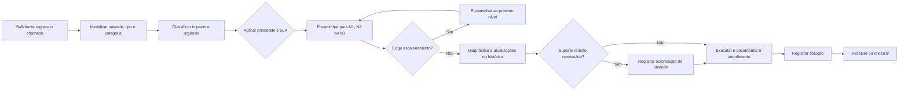

# Central de chamados da Rede Varejo

## Decisão da equipe

O projeto entrega uma solução própria em HTML, CSS e JavaScript para demonstrar o fluxo definido na atividade. A escolha favorece uma demonstração local simples de instalar e adaptar ao cenário da rede. O protótipo não é uma implantação de GLPI nem um sistema de produção.

## Como executar

Abra `varejo.html` em um navegador moderno. Não é necessário instalar pacotes ou iniciar um servidor. O primeiro acesso carrega os dados fictícios da atividade; as alterações são guardadas no `localStorage` do navegador. Use **Exportar backup** para baixar os dados locais em JSON.

## Funcionalidades demonstradas

- Cadastro de chamados com assunto, descrição, tipo, categoria, unidade, solicitante, impacto e urgência.
- Cálculo de prioridade por matriz e cálculo dos prazos de primeira resposta e solução.
- Encaminhamento inicial para N1, N2 ou N3 por regras configuradas; escalonamento manual com histórico.
- Atualização de status, responsável, nível, autorização de suporte remoto e solução.
- Bloqueio de resolução ou encerramento sem solução escrita e de suporte remoto sem autorização registrada.
- Consulta de fila e histórico, busca e filtros por status.
- Catálogo, modelos, artigos de conhecimento, equipes e perfis ilustrativos.
- Indicadores e relatórios por categoria e por unidade, incluindo a matriz.
- Quatorze chamados de demonstração cobrindo os cenários das atividades geral e específica da Equipe 4.

## Dados de demonstração

O conjunto inicial contém 8 solicitantes fictícios e 4 perfis técnicos/supervisores, distribuídos em 3 níveis:

| Grupo | Responsabilidade | Pessoas de demonstração |
|---|---|---|
| N1 | Triagem, dúvidas e procedimentos iniciais | Diego Nunes e Fernanda Melo |
| N2 | Incidentes de maior impacto, PDV e infraestrutura | Caio Souza |
| N3 | Especialistas, recorrência e análise de causa | Patrícia Gomes (supervisora) |

As 8 categorias são **PDV, Internet, Impressão, Estoque, Usuários, Equipamentos da loja, Wi-Fi** e **Integração com matriz**. Os tipos distinguem **Incidente**, **Solicitação de serviço** e **Mudança/melhoria**. Há três modelos e cinco artigos de conhecimento.

## Prioridade e metas de atendimento

A prioridade é calculada a partir do impacto e da urgência. Os tempos abaixo são metas didáticas corridas, em horas/minutos; não há calendário comercial nem monitor de SLA em servidor.

Como o cenário não informa a jornada de funcionamento, o protótipo assume horário de loja de segunda a sábado, das 8h às 22h, no relógio local do navegador. Durante essa janela, chamados de PDV e Internet têm prioridade mínima **Alta**. Fora dela, aplica-se a matriz abaixo. Esta suposição pode ser ajustada em `CONFIG.businessHours`.

| Impacto \ Urgência | Baixa | Média | Alta |
|---|---|---|---|
| Baixo | Baixa | Baixa | Média |
| Médio | Baixa | Média | Alta |
| Alto | Média | Alta | Crítica |

| Prioridade | Primeira resposta | Solução |
|---|---:|---:|
| Crítica | 15 min | 2 h |
| Alta | 1 h | 8 h |
| Média | 4 h | 24 h |
| Baixa | 8 h | 72 h |

## Regras de encaminhamento

1. Chamados de PDV ou Internet durante o horário de operação recebem prioridade mínima Alta e são encaminhados para N2; a matriz pode elevar a prioridade a Crítica.
2. Chamados de Internet com impacto alto também são encaminhados para N2 fora do horário da regra anterior.
3. Chamado recorrente ou que exige análise de causa vai para N3.
4. Dúvidas, acessos e solicitações sem impacto elevado começam em N1.

O atendente também pode escalar manualmente: N1 → N2 → N3. O histórico registra a transição e o responsável.

## Fluxo demonstrado

## Cenários incluídos

Os registros iniciais cobrem dúvida simples e base de conhecimento, redefinição de acesso, falha de um usuário, falha de setor, serviço crítico indisponível, recorrência e análise de causa, suporte remoto autorizado, escalonamento funcional N1→N2, escalonamento técnico N2→N3, mudança/melhoria, PDV que não abre, internet da loja, impressora de recibos, sincronização de estoque, usuário bloqueado, Wi-Fi instável, computador administrativo e novo usuário.

Cada chamado mantém uma lista de eventos com data, autor e descrição. O relatório pode ser exportado em JSON para evidência e conferência dos resultados.

## Segurança e limitações

Este código é um protótipo de front-end: **não implementa autenticação, autorização confiável, banco de dados ou sincronização entre dispositivos**. A troca de perfil serve somente para demonstrar as telas; os controles no navegador não protegem dados contra manipulação. Não utilize nomes, senhas ou informações de clientes reais. Uma implantação real precisa de serviço de autenticação, API e banco de dados com autorização verificada no servidor, armazenamento seguro, validação, política de retenção e notificações.
